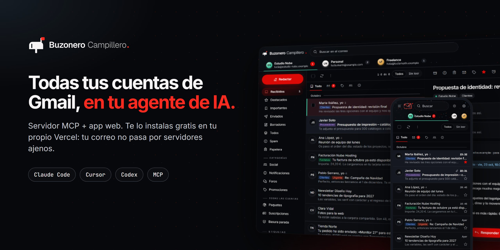
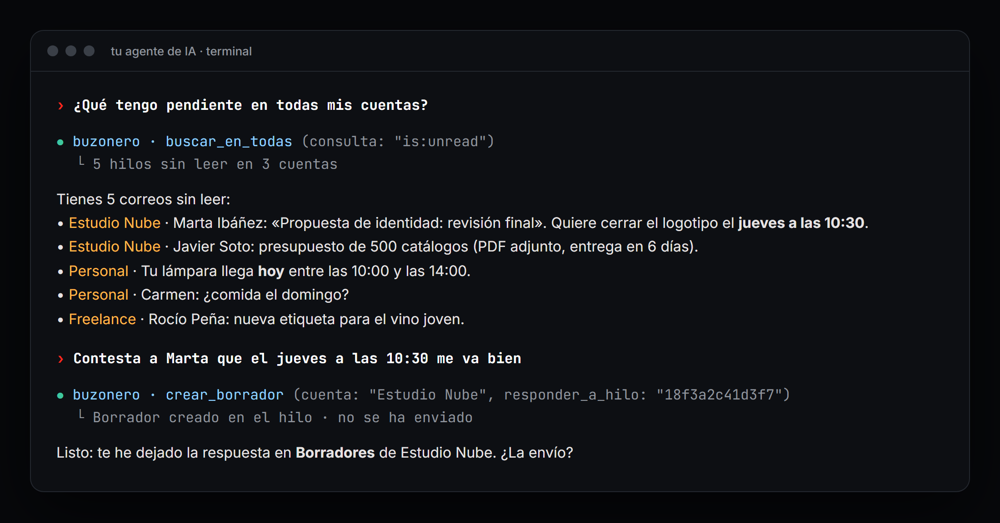
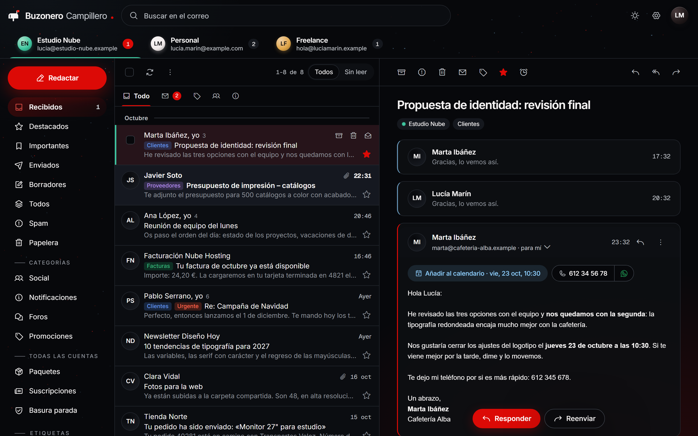
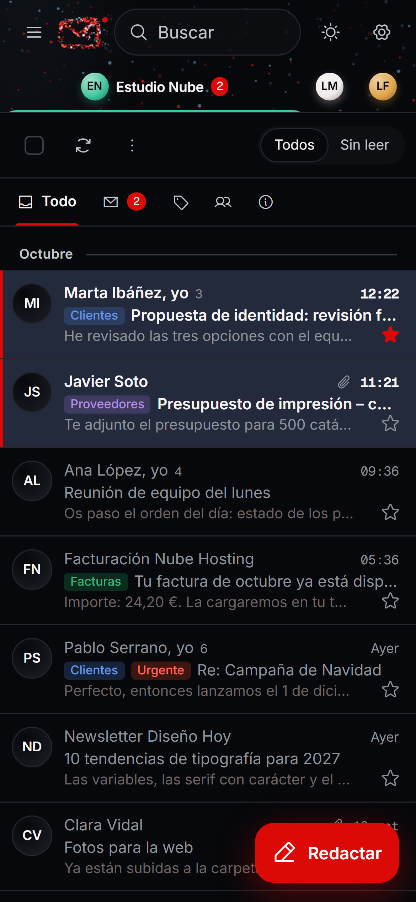
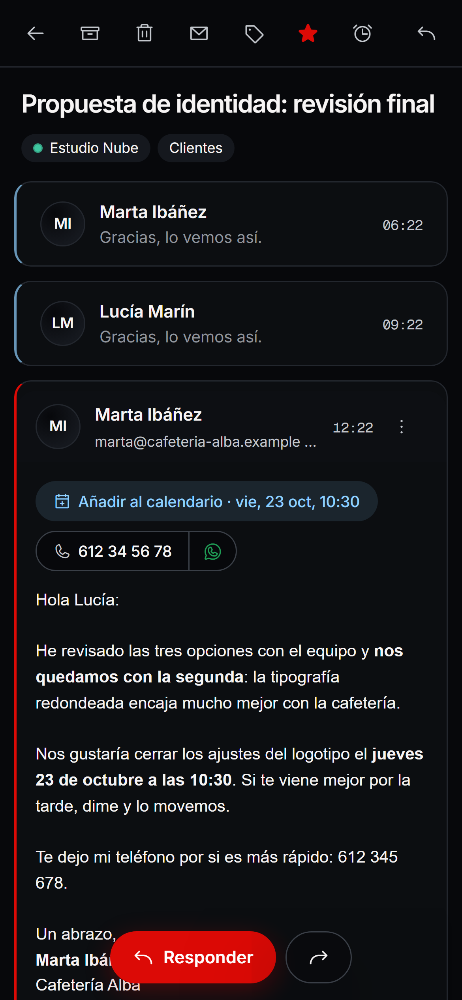
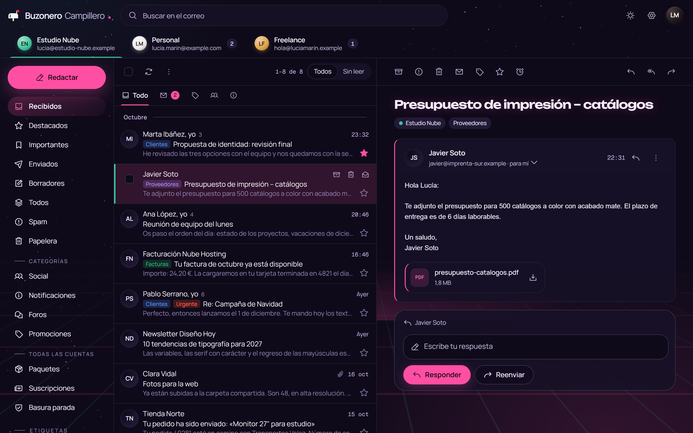

<p align="center">
  
</p>

<h1 align="center">Buzonero Campillero</h1>

<p align="center">
  <strong>All your Gmail accounts, controlled from your AI agent.</strong><br>
  MCP server + web app · self-hosted, free, on your own Vercel
</p>

<p align="center">
  <a href="https://github.com/alerl25/buzonero-campillero/releases"></a>
  <a href="LICENSE"></a>
  
  
  
  
  <a href="https://github.com/alerl25/buzonero-campillero/stargazers"></a>
</p>

<p align="center"><a href="README.md">Español</a> · <strong>English</strong></p>

---

**Buzonero is an MCP server** that gives **Claude Code, Cursor, Codex, Windsurf or Claude Desktop** access to **several Gmail and Google Workspace accounts at once**. Your agent can:
- search all your accounts in one go;
- read mail, write drafts, reply and forward;
- archive and add colored labels;
- unsubscribe from newsletters;
- track your parcels;
- remind you when someone hasn't replied.

It also ships a **web app (PWA)** for desktop and mobile.

Everyone installs their own copy, **for free, on their own Vercel and their own Google Cloud project**, so your mail never goes through anybody else's server.

> The app UI and the tool names are in Spanish, while tool descriptions are self-explanatory to agents. English-speaking users are welcome: your agent will translate as it guides you.

## One-step install

Paste this into your AI agent:

```text
Install Buzonero Campillero for me: https://github.com/alerl25/buzonero-campillero
Follow its AGENTS.md and guide me step by step.
```

Your agent clones the repo, deploys it to your Vercel, generates all the keys and connects the MCP server to itself. You only click through a few screens on Google Cloud, Vercel and cron-job.org, and the agent tells you exactly what to enter. It takes about **20–30 minutes**.

The manual guide is in [INSTALAR.md](INSTALAR.md) (Spanish).

## The MCP server: 37 tools

<p align="center"></p>

| For… | Tools |
|---|---|
| **CRM** | `crm`, `leads` (stage, whose turn it is and Nexudus data for each lead), `mover_lead` (change stage), `anadir_al_crm` (add a thread to the CRM) |
| **Google Calendar** | `calendarios` (calendars), `eventos` (events), `crear_evento`, `modificar_evento`, `borrar_evento` |
| **All accounts at once** | `cuentas` (accounts), `buscar_en_todas` (unified inbox or search across all), `paquetes` (parcels), `suscripciones` (newsletters), `basura_parada` (filtered junk), `avisos_pendientes` (pending follow-ups), `buscar_contacto` (contacts) |
| **Read** | `buscar` (search one account), `leer_hilo` (read thread), `descargar_adjunto` (download attachment) |
| **Write** | `crear_borrador` (draft: new, reply or forward with attachments), `enviar` (send), `enviar_borrador`, `listar_borradores`, `borrar_borrador` |
| **Organize** | `modificar_hilos` (archive, read, star, spam, trash, labels; by ids or by a search), `etiquetas`, `crear_etiqueta` (create colored label), `color_etiqueta` |
| **Follow-up** | `avisame_si_no_contesta` (remind me if no reply), `quitar_aviso` |
| **Clean up** | `darse_de_baja` (one-click unsubscribe + filter), `bloquear_remitente` (block), `filtros`, `crear_filtro`, `borrar_filtro` |
| **Account** | `firma`, `cambiar_firma` (signature) |

> [!IMPORTANT]
> **Safe by default:**
> - It writes **drafts**. Sending, unsubscribing and blocking require `confirmado: true`, so your agent has to ask you first.
> - The MCP server stores no Google credentials. It requests one-hour tokens from your own deployment using its own key.

<details>
<summary><strong>Manual MCP configuration</strong></summary>

<br>

Save the MCP key (the contents of `clave-mcp.txt`) to `~/.config/buzonero/mcp-key.txt`. Below, `PATH` is where you cloned the repo and `YOUR-APP` is your Vercel address.

```bash
# Claude Code
claude mcp add buzonero --scope user -e BUZONERO_URL=https://YOUR-APP.vercel.app -- node "PATH/mcp/buzonero-mcp.mjs"
```

```json
{ "mcpServers": { "buzonero": { "command": "node", "args": ["PATH/mcp/buzonero-mcp.mjs"], "env": { "BUZONERO_URL": "https://YOUR-APP.vercel.app" } } } }
```

</details>

## The app

<p align="center">
  
</p>

<p align="center">
  
  
  
</p>

<sub>Screenshots use a made-up person and made-up emails (`scripts/capturas-demo.mjs`).</sub>

**Mail**
- Multiple accounts in tabs.
- Gmail categories, folders and colored labels.
- Inbox grouped by month and Gmail search syntax.
- Bulk actions and swipe to archive.
- Dark mode inside emails.
- Attachment viewer.
- Drafts that save themselves and signatures per account.

**Writing extras**
- **Undo send** for 10 seconds.
- **Voice dictation**.
- **"Remind me if they don't reply"**.

**Smart extras**
- **Add to calendar** from dates found in the email.
- **Tap-to-call phone numbers**, with WhatsApp.
- **Parcels** across all accounts.
- **One-click unsubscribe**.
- A weekly count of the junk your filters blocked.

**Everywhere**
- Push notifications on iPhone, Android and desktop. Promotional mail doesn't notify you.
- An app icon badge with the unread count.
- The app installs on any device.

**Your way**
- Light, dark and **12 themes**, each with its own font, shapes, background texture and animated particles.

## How it works

- **Your emails are never stored on the server.** The app and the MCP server fetch them straight from Google with one-hour tokens.
- **Google refresh tokens** are kept encrypted with AES-256-GCM in a file in your own Drive that only this app can see.
- **No server-side dependencies and no database.** It's plain Node 20 on Vercel functions.

See [SECURITY.md](SECURITY.md) for the security model and known limits.

## License

[MIT](LICENSE). Not affiliated with Google. Gmail, Google Drive and Google Calendar are trademarks of Google LLC.
