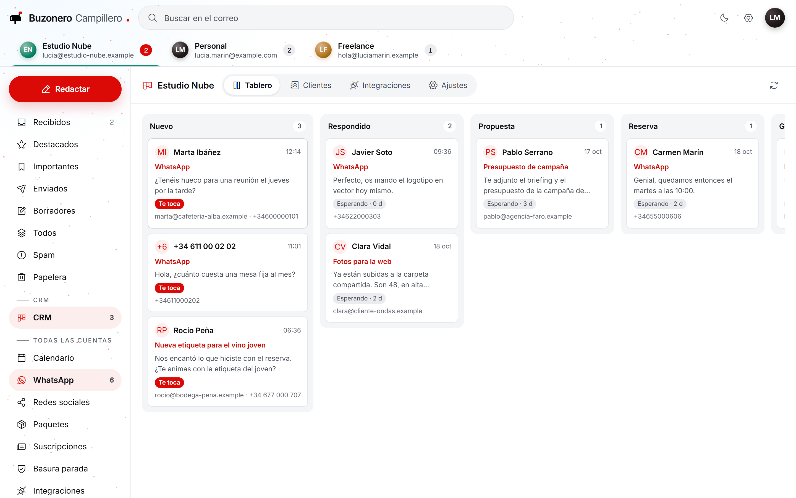
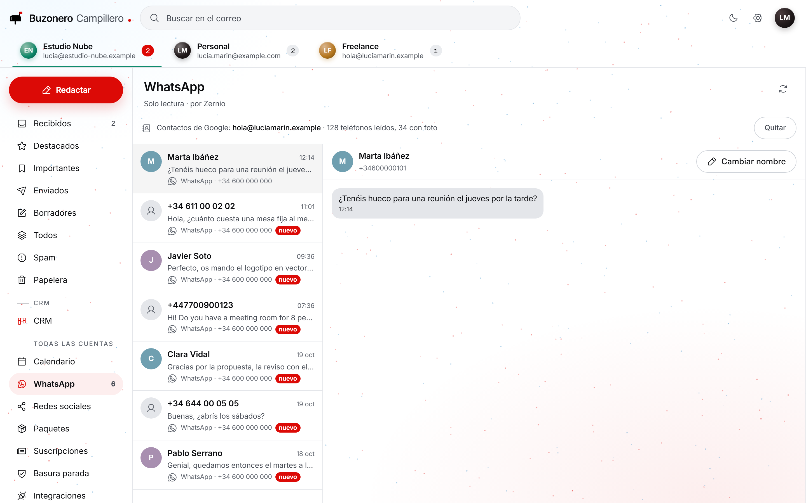
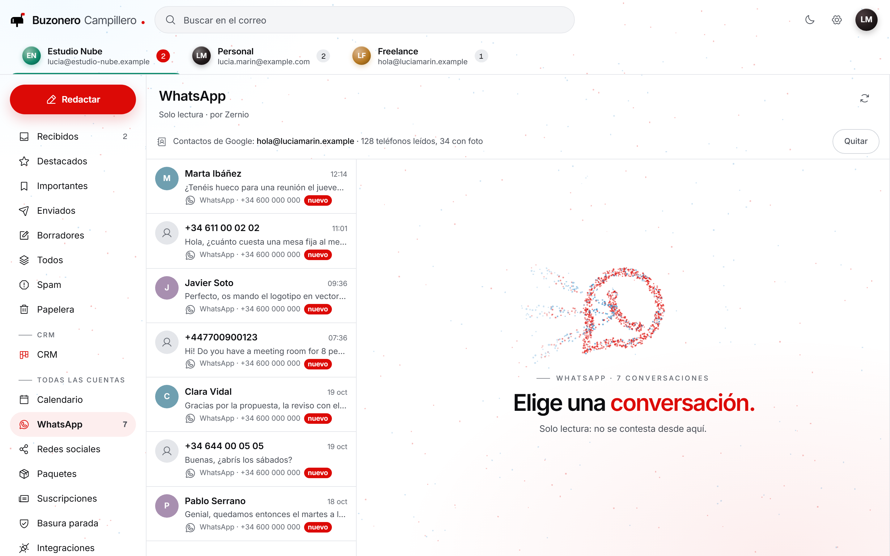
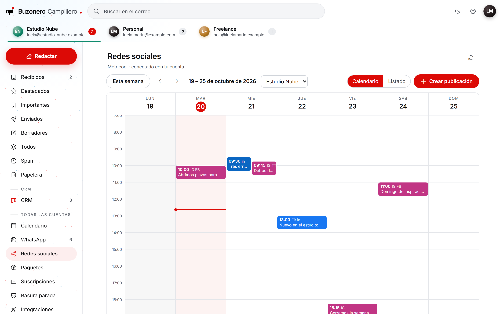
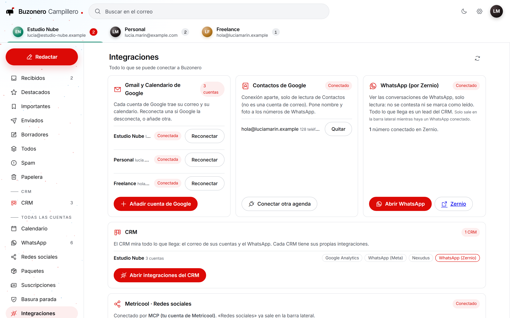
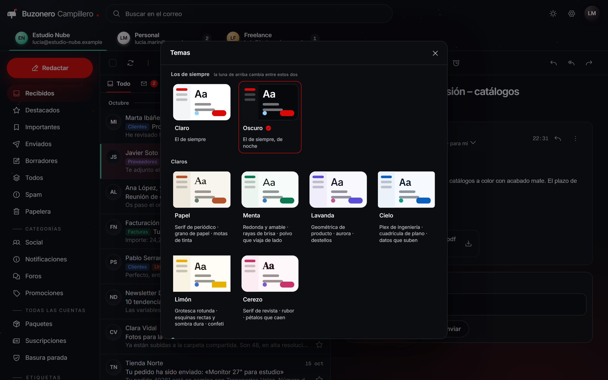
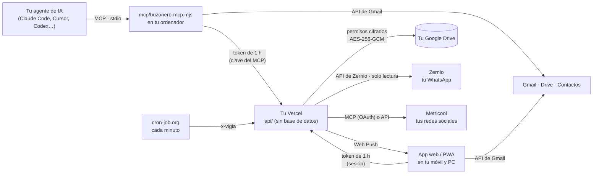

<p align="center">
  
</p>

<h1 align="center">Buzonero Campillero</h1>

<p align="center">
  <strong>Tu correo, tu WhatsApp, tu CRM y tus redes sociales en un solo sitio, con tu agente de IA al mando.</strong><br>
  Servidor MCP + app web · lo instalas tú, gratis, en tu propio Vercel
</p>

<p align="center">
  <a href="https://github.com/alerl25/buzonero-campillero/releases"></a>
  <a href="LICENSE"></a>
  
  
  
  
  <a href="https://github.com/alerl25/buzonero-campillero/stargazers"></a>
</p>

<p align="center">
  <a href="#instalar-en-1-paso">Instalar</a> ·
  <a href="#el-mcp-39-herramientas-para-tu-agente">El MCP</a> ·
  <a href="#la-app">La app</a> ·
  <a href="#las-integraciones">Integraciones</a> ·
  <a href="#cómo-funciona">Cómo funciona</a> ·
  <a href="#preguntas-frecuentes">Preguntas</a> ·
  <a href="README.en.md">English</a>
</p>

---

**Buzonero es un servidor MCP** que da a **Claude Code, Cursor, Codex, Windsurf o Claude Desktop** acceso a **varias cuentas de Gmail y Google Workspace a la vez**. Puedes buscar en todas de una vez, leer, dejar borradores, responder y reenviar, archivar, poner etiquetas de color, darte de baja de boletines, seguir tus paquetes o pedir que te avise si alguien no contesta.

Y trae su **app web** (una PWA que se instala en el ordenador y en el móvil), que va mucho más allá del correo:

- **Correo de todas tus cuentas** en pestañas: bandeja agrupada por meses, búsqueda de Gmail, redactar con adjuntos, deshacer el envío, dictado por voz y «Avísame si no contesta».
- **CRM**: un tablero por etapas que detecta solo los leads que llegan por correo **y por WhatsApp**, y te dice de quién es el turno.
- **WhatsApp** (solo lectura) a través de [Zernio](https://zernio.com): lees las conversaciones, cada una es un lead del CRM y te avisa en el móvil cuando entra un mensaje.
- **Calendario de Google** (día, semana y mes) y **Contactos de Google** (nombres y fotos para los números de WhatsApp).
- **Redes sociales**: un planificador al estilo de Metricool, con calendario semanal, para programar tus publicaciones desde tu cuenta de Metricool.
- **Integraciones**: un panel con todo lo que se puede conectar, y solo aparece en la barra lateral lo que de verdad usas.
- Además: paquetes, suscripciones, basura parada, avisos al móvil y 12 temas.

Cada persona se lo instala **gratis, en su propio Vercel y con su propio proyecto de Google**. Tu correo no pasa por ningún servidor ajeno, tampoco por el de quien escribió esto.

## Instalar en 1 paso

Copia esto en tu agente de IA:

```text
Instálame Buzonero Campillero: https://github.com/alerl25/buzonero-campillero
Sigue su AGENTS.md y guíame paso a paso.
```

Tu agente lo clona, lo publica en tu Vercel, genera las claves y se conecta el MCP. A ti solo te pide unos clics en Google Cloud, Vercel y cron-job.org, y te dice exactamente qué poner. Calcula **20-30 minutos**.

¿Prefieres hacerlo a mano? Tienes la guía completa en **[INSTALAR.md](INSTALAR.md)**.

## El MCP: 39 herramientas para tu agente

<p align="center"></p>

| Para… | Herramientas |
|---|---|
| **CRM** | `crm`, `leads` (etapa, de quién es el turno y Nexudus de cada lead), `mover_lead`, `anadir_al_crm` |
| **WhatsApp** (solo lectura) | `whatsapp` (las conversaciones recientes), `whatsapp_leer` (los mensajes de una conversación) |
| **Calendario de Google** | `calendarios`, `eventos`, `crear_evento`, `modificar_evento`, `borrar_evento` |
| **Ver todas las cuentas a la vez** | `cuentas`, `buscar_en_todas` (bandeja unificada o búsqueda en todas), `paquetes`, `suscripciones`, `basura_parada`, `avisos_pendientes`, `buscar_contacto` |
| **Leer** | `buscar`, `leer_hilo`, `descargar_adjunto` |
| **Escribir** | `crear_borrador` (nuevo, respuesta o reenvío con adjuntos), `enviar`, `enviar_borrador`, `listar_borradores`, `borrar_borrador` |
| **Ordenar** | `modificar_hilos` (archivar, leído, destacar, spam, papelera, etiquetas; por ids o por una búsqueda), `etiquetas`, `crear_etiqueta`, `color_etiqueta` |
| **Seguimiento** | `avisame_si_no_contesta`, `quitar_aviso` |
| **Limpiar** | `darse_de_baja`, `bloquear_remitente`, `filtros`, `crear_filtro`, `borrar_filtro` |
| **Cuenta** | `firma`, `cambiar_firma` |

**Prueba a pedirle a tu agente:**
- «¿Qué tengo sin leer en todas mis cuentas?»
- «Responde a Laura desde la cuenta del trabajo diciendo que el jueves me va bien» (deja un borrador).
- «Date de baja de los boletines que nunca abro.»
- «¿Qué paquetes tengo de camino?»
- «Avísame si el proveedor no contesta en 3 días.»
- «Archiva todo lo de LinkedIn de más de una semana en las tres cuentas.»
- «¿Qué me han escrito hoy por WhatsApp?» (solo lee: no contesta ni marca nada como leído).

> [!IMPORTANT]
> **Seguro por defecto:**
> - Escribe **borradores**. Enviar, darse de baja y bloquear piden `confirmado: true`, así que tu agente tiene que preguntarte antes.
> - El MCP no guarda tus permisos de Google: pide a tu instalación tokens de una hora con su propia clave.
> - **WhatsApp es solo lectura**: tu agente puede leer las conversaciones, pero no contestar ni marcarlas como leídas (en WhatsApp eso mandaría el doble check azul al cliente).
> - **El MCP no tiene herramientas de redes sociales**: tu agente no puede publicar por ti. Programar se hace solo desde la app, con tu confirmación.

<details>
<summary><strong>Configuración del MCP para cada agente</strong> (si no lo hizo tu agente al instalar)</summary>

<br>

Guarda la clave del MCP (el contenido de `clave-mcp.txt`) en `~/.config/buzonero/mcp-key.txt`. `RUTA` es la carpeta donde clonaste el repositorio y `TU-APP` es tu dirección de Vercel.

**Claude Code**

```bash
claude mcp add buzonero --scope user -e BUZONERO_URL=https://TU-APP.vercel.app -- node "RUTA/mcp/buzonero-mcp.mjs"
```

**Cursor** (`~/.cursor/mcp.json`), **Windsurf** y **Claude Desktop**

```json
{
  "mcpServers": {
    "buzonero": {
      "command": "node",
      "args": ["RUTA/mcp/buzonero-mcp.mjs"],
      "env": { "BUZONERO_URL": "https://TU-APP.vercel.app" }
    }
  }
}
```

**VS Code** (`.vscode/mcp.json`)

```json
{
  "servers": {
    "buzonero": {
      "type": "stdio",
      "command": "node",
      "args": ["RUTA/mcp/buzonero-mcp.mjs"],
      "env": { "BUZONERO_URL": "https://TU-APP.vercel.app" }
    }
  }
}
```

**Codex** (`~/.codex/config.toml`)

```toml
[mcp_servers.buzonero]
command = "node"
args = ["RUTA/mcp/buzonero-mcp.mjs"]
env = { BUZONERO_URL = "https://TU-APP.vercel.app" }
```

</details>

## La app

<p align="center">
  
</p>

<p align="center">
  
  
  
</p>

<sub>Las capturas usan una persona, unos correos, unos teléfonos y unas marcas inventados (`scripts/capturas-demo.mjs`).</sub>

**Correo**
- Varias cuentas en pestañas, cada una con su color y su contador de sin leer.
- Categorías de Gmail (Principal, Promociones, Social, Notificaciones), carpetas y etiquetas de color. El color lo eliges al crear la etiqueta o tocando su cuadradito.
- Bandeja agrupada por meses y búsqueda con la sintaxis de Gmail.
- Acciones en bloque, y deslizar para archivar en el móvil.
- El correo se ve con tu tema, también en oscuro. La parte citada sale plegada y los adjuntos tienen visor (PDF, imágenes y documentos).
- Redactar y responder con adjuntos (los grandes van a Drive), una firma por cuenta y borradores que se guardan solos.
- **Deshacer el envío** durante 10 segundos.
- **Dictado por voz**: limpia muletillas y entiende «punto y aparte», «coma», «interrogación»…
- **«Avísame si no contesta»**: si nadie responde en el plazo que elijas, el hilo vuelve a tu bandeja con la etiqueta «Sin respuesta» y te llega un aviso.

**Lo que encuentra por ti**
- **Añadir al calendario**: detecta fechas y horas en el correo y crea el evento en Google Calendar.
- **Teléfonos y direcciones**: los convierte en botones de llamada, WhatsApp y mapa.
- **Calendario de Google**: Día, Semana y Mes de todos tus calendarios en una pestaña, con un check por cuenta y por calendario como en Google Calendar. Crear, editar, arrastrar y borrar eventos desde aquí.
- **Paquetes**: reúne en una pestaña los pedidos y envíos de todas las cuentas, con su estado.
- **Suscripciones**: lista los boletines y te deja darte de baja en un clic o filtrarlos. Te señala los que nunca abres.
- **Basura parada**: cuenta lo que tus filtros apartan cada semana.

**CRM** (botón «CRM» de la barra lateral)

<p align="center"></p>

- **Tablero por etapas** (Nuevo, Respondido, Propuesta, Reserva, Ganado, Perdido; las cambias tú) y arrastrar tarjetas entre ellas. Cada tarjeta dice si **te toca** contestar o si estás **esperando**.
- **Un CRM por negocio**, con sus cuentas de correo. Pestañas: Tablero, Clientes, Integraciones y Ajustes.
- **Detecta los leads solo**: formularios de tu web, correos directos de personas nuevas y palabras clave que eliges; aparta los bots y tiene «No es lead». La etapa de cada lead es una etiqueta de tu Gmail (`Leads/…`), así que también la ves desde Gmail.
- **Todo lo que llega por WhatsApp es un lead**, sin filtrar (integración «WhatsApp (Zernio)»); solo cuentan las conversaciones con movimiento en los últimos 7 días, para que las viejas y cerradas no engorden el tablero.
- **Etapas automáticas**: si contestas, pasa a Respondido; con [Nexudus](https://www.nexudus.com) conectado, una reserva lo pasa a Reserva y una factura pagada a Ganado.
- «Añadir al CRM» en cualquier correo.

**WhatsApp** (solo lectura, por [Zernio](https://zernio.com))

<p align="center"></p>

- Lista de conversaciones con el chat al lado. **Es de solo lectura por diseño**: no hay en el servidor ningún camino para enviar, y no marca los mensajes como leídos (en WhatsApp eso mandaría el doble check azul al cliente).
- **Nombres legibles**: el nombre que tú pones («Poner nombre»), el que trae WhatsApp o, si no hay, el número bien escrito (`+34 600 55 05 78`).
- **Fotos de perfil**: WhatsApp no las da a las empresas. Si conectas tus **Contactos de Google**, salen el nombre y la foto de quien tengas en tu agenda; si no, unas iniciales de color.
- **Se actualiza solo**, como el correo: cada 10 segundos con la vista abierta, también la conversación que estás leyendo, sin saltos de pantalla.
- **Aviso al móvil** cuando entra un WhatsApp nuevo (solo de lo que escribe el cliente, no de tus respuestas).
- El panel vacío lleva un icono de partículas, como el sobre del correo.
- Solo sale en la barra lateral si tienes un WhatsApp conectado.

<p align="center"></p>

**Redes sociales** (planificador al estilo de Metricool)

<p align="center"></p>

- **Calendario semanal** de lunes a domingo, de 0:00 a 23:59: cada publicación programada en su día y su hora, con el color de su red; las que se pisan se reparten en columnas; línea de la hora actual; «Esta semana», flechas y selector de marca. También hay vista **Listado**.
- **Pulsar un hueco libre** abre «Crear publicación» con esa hora; pulsar una publicación la abre con su texto entero y el enlace a Metricool.
- **Crear publicación**: texto, redes de esa marca (Facebook, Instagram, LinkedIn, TikTok, X, Bluesky, Threads y Google Business), día y hora, y enlaces `https` de imágenes o vídeos. **Pide confirmación** y solo se programa cuando tú lo pulsas.
- Se conecta a **tu cuenta de Metricool** de dos maneras: **por MCP** (entras en Metricool y das permiso; vale en cualquier plan, sin token) o **por API** (con tu token; planes Advanced o Custom de Metricool).
- Solo sale en la barra lateral si Metricool está conectado. Con la conexión por MCP no se puede editar ni borrar desde aquí (Metricool no ofrece esa herramienta): se hace en Metricool.

**Integraciones** (botón siempre visible de la barra lateral)

<p align="center"></p>

Un solo sitio para ver y gestionar todo lo que se puede conectar (la tabla completa está [más abajo](#las-integraciones)).

**Avisos y móvil**
- Avisos de correo nuevo **y de WhatsApp nuevo** en el móvil y en el ordenador (Web Push, también en iPhone). La publicidad no avisa.
- Globo con el número de sin leer en el icono de la app.
- Se instala como app en iPhone, Android y escritorio.

**A tu gusto**
- Claro, oscuro y **12 temas** con personalidad propia: letra, esquinas, textura de fondo y partículas animadas (nieve, burbujas, luciérnagas, estrellas, píxeles, confeti…).

<p align="center"></p>

## Las integraciones

Todo es opcional salvo Gmail. Se gestiona desde el botón **Integraciones** de la barra lateral.

| Integración | Qué hace | Qué necesitas | Coste |
|---|---|---|---|
| **Gmail y Calendario de Google** | Correo y calendario de varias cuentas, a la vez | Un proyecto de Google Cloud (guía de instalación) | 0 € |
| **Contactos de Google** | Nombre y foto para los números de WhatsApp. Conexión **aparte y solo de lectura**: no es una cuenta de correo | La misma API People que ya activaste; se conecta con un botón | 0 € |
| **WhatsApp (Zernio)** | Ver las conversaciones (solo lectura), leads del CRM, avisos al móvil | Una cuenta de [Zernio](https://zernio.com) con tu WhatsApp conectado y su clave en la variable `ZERNIO_API_KEY` | Las 2 primeras cuentas de Zernio son gratis. Meta cobra los mensajes que empieza tu empresa; Buzonero no envía ninguno |
| **CRM** | Tablero de leads por etapas | Nada: se crea desde el botón CRM | 0 € |
| **Google Analytics** (en el CRM) | Visitas de tu web en la ficha del CRM | Una cuenta de servicio de Google | 0 € |
| **WhatsApp Business de Meta** (en el CRM) | Números de WhatsApp directos con la API de Meta | Token de Meta | Lo que cobre Meta |
| **Nexudus** (en el CRM) | Facturas y reservas de cada cliente, en solo lectura | Usuario o token de tu espacio | Tu plan de Nexudus |
| **Metricool** | Planificador de redes sociales con calendario | Tu cuenta de Metricool: por **MCP**, cualquier plan; por **API**, plan Advanced o Custom | Según tu plan de Metricool |
| **Google Business Profile** (en el CRM) | Reseñas y estadísticas de tu ficha | Aprobación de Google | En espera de que Google lo apruebe |

## Cómo funciona



- **Tus correos nunca se guardan en el servidor.** La app y el MCP los piden directamente a Google con tokens que caducan en una hora.
- **Los permisos de Google** (refresh tokens) viven cifrados en un fichero de tu Drive que solo ve esta app.
- **Sin dependencias** en el servidor ni en el MCP: es Node 20 puro, y por tanto hay menos que auditar.

| Ruta | Qué es |
|---|---|
| `mcp/buzonero-mcp.mjs` | El servidor MCP: un solo fichero, sin dependencias, habla MCP por stdio |
| `app/index.html` | La app: un HTML con su JavaScript, sin compilación. Las vistas grandes van en ficheros aparte: `crm.js` (CRM), `calendario.js`, `mensajes.js` (WhatsApp), `integraciones.js` y `redes.js` (Metricool) |
| `app/tema.css` · `app/particulas.js` | Diseño, temas (`scripts/temas.py`) y fondo de partículas en WebGL |
| `api/` | Funciones de Vercel: sesión, acceso con Google, tokens, avisos, almacén cifrado, CRM y `zernio.js` (el enrutador de integraciones: WhatsApp, Contactos y Metricool). El plan gratis de Vercel admite **12 funciones** y ya están usadas, así que lo nuevo va dentro de una existente; los ficheros `api/_*.js` son ayudas y no cuentan |
| `sw.js` | Service worker: avisos y globo del icono |
| `AGENTS.md` | Las instrucciones que sigue tu agente para instalártelo |
| `scripts/` | `configurar.mjs` (claves), `subir-a-vercel.mjs`, `capturas-demo.mjs` e `imagenes-readme.mjs` |

## Preguntas frecuentes

<details><summary><strong>¿Cuánto cuesta?</strong></summary><br>El correo, el CRM y el calendario: 0 €. Vercel Hobby, Google Cloud sin facturación y cron-job.org son gratuitos para este uso. Si algún paso te pide tarjeta, te has equivocado de opción. <b>WhatsApp (Zernio) y Metricool son opcionales</b> y dependen de sus propios planes: Zernio da gratis las 2 primeras cuentas conectadas y leer mensajes no cuesta; Meta cobra los mensajes que empieza tu empresa (Buzonero no envía ninguno); en Metricool, por MCP vale cualquier plan y por API hace falta Advanced o Custom.</details>

<details><summary><strong>¿Alguien más puede leer mi correo?</strong></summary><br>No. Es tu instalación: tu proyecto de Google, tu Vercel y tu ordenador. Quien escribió Buzonero no tiene ningún acceso. Los permisos se guardan cifrados en tu Drive y los correos no se guardan en ningún servidor.</details>

<details><summary><strong>¿Por qué Google dice «aplicación no verificada»?</strong></summary><br>Porque es tu propia app y no ha pasado la auditoría de Google, que es de pago y está pensada para apps públicas. Para uso personal basta con publicarla «En producción» sin verificar (así no caduca a los 7 días) y pulsar <em>Configuración avanzada → Ir a Buzonero</em>.</details>

<details><summary><strong>¿Funciona con Google Workspace (correo de empresa)?</strong></summary><br>Sí, siempre que el administrador de tu dominio permita apps de terceros. Puedes mezclar cuentas de Gmail y de Workspace.</details>

<details><summary><strong>¿Puede mi agente enviar correos sin preguntarme?</strong></summary><br>No. <code>enviar</code>, <code>enviar_borrador</code>, <code>darse_de_baja</code> y <code>bloquear_remitente</code> no hacen nada sin <code>confirmado: true</code>, y las instrucciones del MCP le dicen al agente que te pregunte. Por defecto deja borradores.</details>

<details><summary><strong>¿Puede mi agente publicar en mis redes o escribir por WhatsApp?</strong></summary><br>No. El MCP no tiene ninguna herramienta de redes sociales y la de WhatsApp es solo de lectura (<code>whatsapp</code> y <code>whatsapp_leer</code>). Programar una publicación se hace solo desde la app, con tu sesión y tu confirmación en pantalla, y el servidor rechaza esas acciones si llegan con la clave del MCP.</details>

<details><summary><strong>¿Qué guarda Buzonero de WhatsApp, Metricool y Contactos?</strong></summary><br>Los mensajes de WhatsApp no se guardan: se leen de Zernio cada vez. Se guardan, cifrados en tu Drive, los nombres que pones a los números, la etapa de cada lead, el permiso de Metricool (o su token) y el permiso de Contactos de Google. Los contactos en sí no se guardan: se cruzan por teléfono en el servidor y a la pantalla solo llegan el nombre y la foto de quien te escribió. La clave de Zernio vive solo en las variables de tu Vercel.</details>

<details><summary><strong>¿Por qué Metricool dice «Aplicación no verificada»?</strong></summary><br>Porque Buzonero se registra ante Metricool como una app tuya (registro dinámico de clientes OAuth, con PKCE) y Metricool avisa de que no es una app suya. Es normal: revisa los permisos y acepta. Puedes quitarlo cuando quieras desde Integraciones. Ten en cuenta que ese permiso es amplio (ver y gestionar tus marcas, métricas y publicar).</details>

<details><summary><strong>¿Tengo que cambiar mi número para conectar WhatsApp?</strong></summary><br>Conectar un número a la API de WhatsApp Business puede dejar de funcionar en la app del móvil. Usa un número nuevo, o mira antes lo que dicen Meta y Zernio sobre la «coexistencia».</details>

<details><summary><strong>¿Cuántas cuentas puedo conectar?</strong></summary><br>Las que quieras: la principal al instalar y el resto desde la app (engranaje → Añadir cuenta).</details>

<details><summary><strong>¿Y si pierdo el móvil o se filtra una clave?</strong></summary><br>Cambia <code>BZ_SESION_VER</code> en Vercel para cerrar todas las sesiones, cambia la clave que corresponda y retira permisos en <a href="https://myaccount.google.com/permissions">myaccount.google.com/permissions</a>. Lo tienes en <a href="SECURITY.md">SECURITY.md</a>.</details>

## Contribuir

Los fallos, las ideas y las mejoras son bienvenidos: lee [CONTRIBUTING.md](CONTRIBUTING.md). Para un problema de seguridad, usa el aviso privado que explica [SECURITY.md](SECURITY.md).

## Historial de estrellas

<a href="https://star-history.com/#alerl25/buzonero-campillero&Date">
  <picture>
    <source media="(prefers-color-scheme: dark)" srcset="https://api.star-history.com/svg?repos=alerl25/buzonero-campillero&type=Date&theme=dark">
    
  </picture>
</a>

## Licencia

[MIT](LICENSE). Úsalo, cámbialo y compártelo libremente.

<sub>Buzonero Campillero no está afiliado a Google. Gmail, Google Drive y Google Calendar son marcas de Google LLC.</sub>
